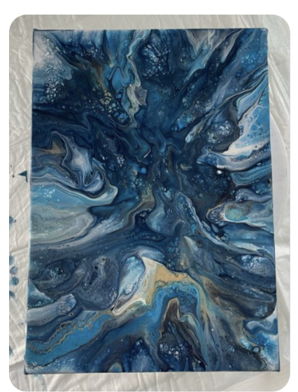
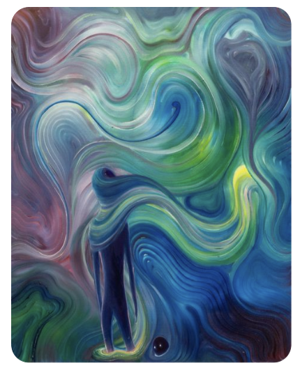
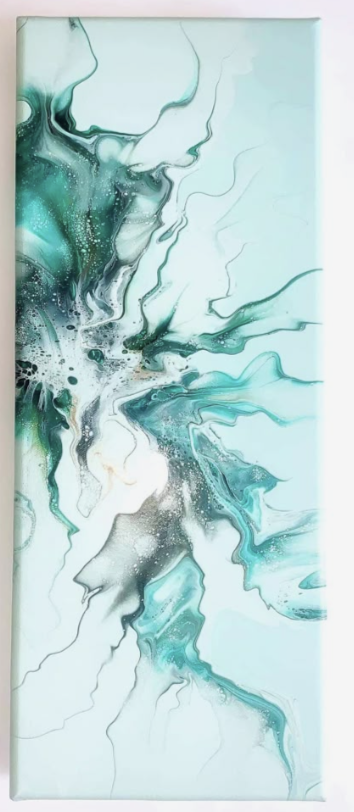
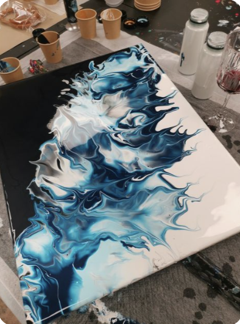
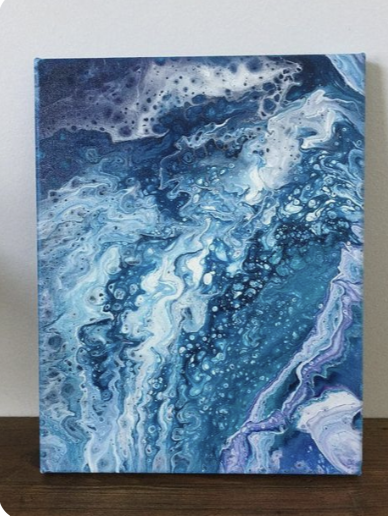
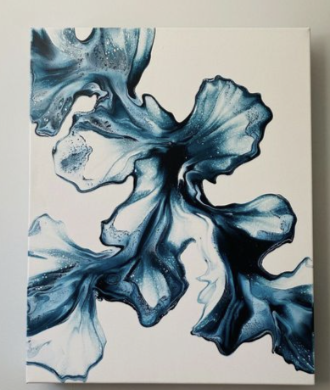

# Dirección visual — referentes y paleta (23/10/2026)

## Referentes
Lo que Valen se imagina visualmente: arte fluido (acrylic pouring). Azules profundos sobre oscuro, blancos y turquesas, venas finas que se ramifican, corrientes que se enroscan y vetas doradas.

| | | |
|---|---|---|
|  |  |  |
|  |  |  |

## Paleta (aprobada por Valen)
| Elemento | Color | Referencia en las imágenes |
|---|---|---|
| Fondo | `#050b14` azul casi negro | zonas oscuras |
| Fiel | `#e8f1f5` blanco hielo cálido, trazos finos y nítidos | líneas blancas |
| Desvío | `#2fb8b0` turquesa, venas coherentes | ramas verdes/turquesa |
| Deriva | `#1b3a5c` azul profundo apagado, casi se funde con el fondo | fondos azules |
| Conservado | `#c9a46a` dorado tenue | vetas doradas |

## Decisión
- **Valen decidió** usar el dorado como la única señal visual del juicio: marca lo que la persona conservó y nada más.
  Esto respeta que la obra no concluye por la persona: el sistema no colorea "lo bueno", solo lo que ella eligió.
- Los agentes se dibujan como trazos cortos orientados según su rumbo.
- Las trazas se dibujan desde la malla suavizada, para que los canales se mezclen como pintura (hito 5).

## Qué decidí / qué delegué (propuesta de línea para la ficha, sección 10)
| Dirección visual: referentes, paleta y dorado como señal del juicio | Yo (referentes y aprobación); delegué la propuesta de códigos de color y la forma de los agentes | |
